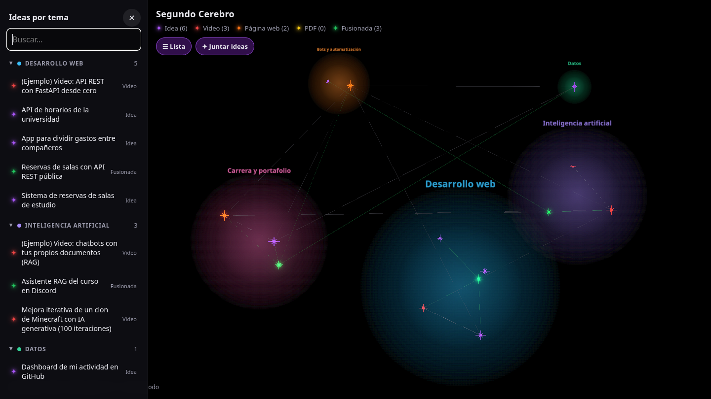
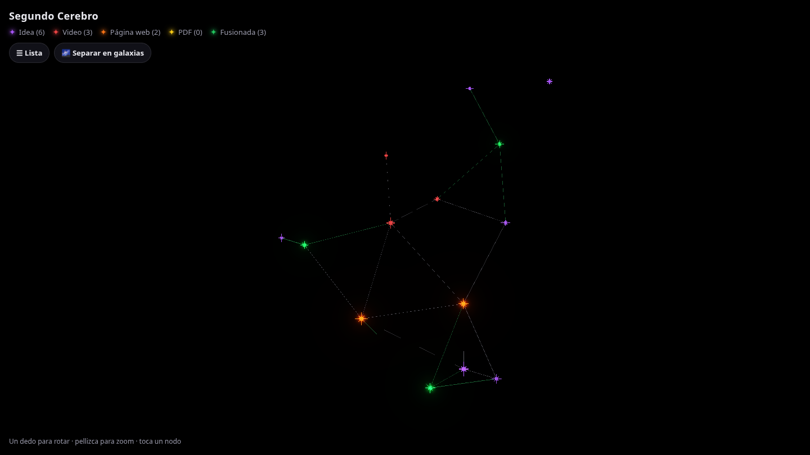
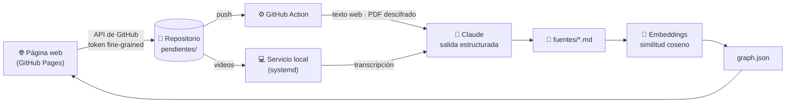

<div align="center">

# 🧠 Segundo Cerebro

**Grafo 3D de conocimiento que aprende de videos, artículos y PDFs, y los convierte en ideas de proyecto conectadas por significado.**

[](https://arrobaaas.github.io/segundo-cerebro/web/)


[](LICENSE)



</div>

---

## Tabla de contenidos

- [El problema](#el-problema)
- [Características](#características)
- [Arquitectura](#arquitectura)
- [Stack tecnológico](#stack-tecnológico)
- [Decisiones técnicas](#decisiones-técnicas)
- [Instalación](#instalación)
- [Uso](#uso)
- [Configuración del modo automático](#configuración-del-modo-automático)
- [Estructura del proyecto](#estructura-del-proyecto)
- [Formato de los datos](#formato-de-los-datos)
- [Seguridad](#seguridad)
- [Hoja de ruta](#hoja-de-ruta)
- [Licencia](#licencia)

## El problema

Consumo muchos videos, artículos y documentos técnicos, pero lo aprendido queda disperso y
rara vez se transforma en algo concreto. **Segundo Cerebro** resuelve eso:

1. **Captura** una fuente (link de YouTube, página web o PDF) con un solo clic desde la web o el celular.
2. **Resume** su contenido con IA, enfocado en un perfil profesional concreto, y propone
   **ideas de proyecto viables** con su MVP.
3. **Conecta** cada nodo con los demás por **similitud semántica** (embeddings), sin etiquetas manuales.
4. **Visualiza** todo como un grafo 3D navegable, agrupable en "galaxias" por tema.

## Características

| | |
|---|---|
| 🌌 **Visor 3D interactivo** | Grafo de fuerzas con estrellas, brillo (*bloom*), zoom y rotación. Funciona en escritorio y celular. |
| 🪐 **Modo galaxias** | Separa las ideas en una galaxia por tema (web, IA, datos, ciberseguridad, videojuegos…), con nebulosa y nombre. Un botón las vuelve a juntar. |
| 📚 **Lista lateral** | Panel ocultable con todas las ideas agrupadas por tema y un buscador que ignora mayúsculas y tildes. |
| 🎨 **Tipos de fuente** | Idea, Video, Página web, PDF y Fusionada, cada uno con su color. |
| ⚡ **Ingesta automática** | Pegas un link o subes un PDF y una **barra de progreso** sigue en vivo cada paso del análisis hasta que aparece la estrella nueva. |
| 💡 **Ideas a partir de cada fuente** | Cada video, artículo o PDF genera 2 o 3 **nodos de idea propios** (descripción, MVP, tecnologías y tema), enlazados a su fuente. Cada idea puede caer en otra galaxia que su fuente. |
| 🧩 **Clasificación por tema** | Claude elige el tema de cada fuente nueva; los nodos sin tema se clasifican solos por similitud de embeddings. |
| 🛠️ **Planes de desarrollo** | Genera un plan por fases (objetivo, tareas, entregable, criterio de terminado y un *prompt* listo por fase) para convertir una idea en proyecto. |
| 🔒 **Seguro por diseño** | Sin claves en el navegador, PDFs cifrados de extremo a extremo, CSP estricta y dependencias fijadas. |

<details>
<summary><b>Ver la vista normal del grafo</b></summary>
<br>

</details>

## Arquitectura

La aplicación es **100 % estática** (GitHub Pages): no hay servidor propio. El repositorio
funciona como base de datos y cola de trabajos, y el procesamiento ocurre en GitHub Actions
o, para los videos, en el computador local.



**Flujo de una fuente nueva:**

1. La página guarda `pendientes/<id>.json` en el repositorio usando la API de GitHub.
   Los PDF se **cifran en el navegador** (`RSA-OAEP` + `AES-256-GCM`) antes de subirse.
2. El *push* dispara la Action, que extrae el texto (`trafilatura`) o descifra el PDF y pide a
   Claude un resumen con **salida estructurada** validada por un esquema JSON (Pydantic).
3. Los **videos de YouTube** van a una cola aparte que procesa un servicio en el computador
   local, porque YouTube bloquea las transcripciones pedidas desde servidores en la nube.
4. `build_graph.py` calcula los embeddings, crea los enlaces y publica `graph.json`.
5. La página sigue cada paso con la API de Actions, muestra el porcentaje y se recarga sola.

## Stack tecnológico

| Capa | Tecnologías |
|---|---|
| **Frontend** | HTML, CSS y JavaScript (módulos ES, sin framework) · [3d-force-graph](https://github.com/vasturiano/3d-force-graph) · Three.js · Web Crypto API |
| **Procesamiento** | Python 3.12 · `sentence-transformers` (`paraphrase-multilingual-MiniLM-L12-v2`) · `trafilatura` · `youtube-transcript-api` · Pydantic · `cryptography` |
| **IA generativa** | Claude (Opus) mediante el SDK de Anthropic o Claude Code en modo no interactivo, con salida estructurada |
| **Datos** | Markdown con *frontmatter* YAML, un archivo por nodo (versionado con Git) |
| **Infraestructura** | GitHub Pages · GitHub Actions · GitHub Secrets · servicio de usuario `systemd` |

## Decisiones técnicas

- **Embeddings en vez de palabras clave.** Dos ideas se conectan si *significan* algo parecido,
  aunque no compartan palabras. El modelo es multilingüe y corre en CPU, sin GPU.
- **Sin backend propio.** El repositorio cumple el rol de base de datos (Markdown versionado) y de
  cola de trabajos (`pendientes/`). Se publica gratis en GitHub Pages y no hay servidor que mantener.
- **Salida estructurada.** Claude responde siguiendo un esquema JSON (incluido un `enum` de temas),
  así el formato nunca se rompe y no hace falta "adivinar" la respuesta.
- **Umbral de similitud calibrado.** Con textos cortos en español la mediana de similitud ronda
  0,3, así que el umbral es 0,45 en vez del típico 0,6. Además, cada nodo aislado se conecta con su
  vecino más cercano (≥ 0,3). El script muestra mínimo, mediana y máximo para recalibrar.
- **Procesamiento híbrido nube/local.** Como YouTube bloquea a los servidores en la nube, los videos
  se procesan con un servicio local que trabaja sobre una copia aparte del repositorio. Si el
  computador está apagado, esperan en cola.
- **Cifrado de extremo a extremo para PDFs.** El repositorio es público, pero los PDFs se suben
  cifrados: solo la Action, que tiene la clave privada en GitHub Secrets, puede leerlos.
- **Física de galaxias a medida.** El modo galaxias usa una fuerza de d3 escrita a mano que atrae
  cada nodo al centro de su tema y debilita los enlaces entre temas distintos.

## Instalación

**Requisitos:** Python 3.12+, Git y un navegador moderno.

```bash
git clone https://github.com/arrobaaas/segundo-cerebro.git
cd segundo-cerebro

python3 -m venv .venv
source .venv/bin/activate
pip install torch --index-url https://download.pytorch.org/whl/cpu   # PyTorch liviano, sin GPU
pip install -r requirements.txt

git config core.hooksPath .githooks   # activa el hook que bloquea commits con claves
```

> `requirements.txt` lista las dependencias directas; `requirements.lock` (generado con
> `bash scripts/actualizar_dependencias.sh`) las fija todas con su huella para la Action.

Para levantar el visor en local:

```bash
cd web && python3 -m http.server 8000   # abrir http://localhost:8000
```

> El navegador bloquea `fetch()` sobre `file://`, por eso se necesita un servidor y no basta
> con abrir `index.html` con doble clic. Para probar en el celular, usa la IP local del
> computador (`hostname -I`) estando en la misma red wifi.

## Uso

### Desde la web

| Acción | Cómo |
|---|---|
| Explorar | Arrastra para rotar, rueda o pellizco para zoom y clic en una estrella para ver su detalle y conexiones. |
| Agrupar por tema | Botón **🌌 Separar en galaxias** / **✦ Juntar ideas**. |
| Buscar | Botón **☰ Lista**: ideas agrupadas por tema, con buscador. |
| Agregar una fuente | Botón **＋ Fuente** (solo en tus dispositivos): pega un link o sube un PDF. |
| Desarrollar una idea | En el panel de una idea: **Copiar y abrir Claude** arma un prompt con tu perfil, la idea y sus conexiones. |

Para conectar un dispositivo nuevo, abre la página con `#editar` al final de la URL y pega un
[token *fine-grained*](https://github.com/settings/personal-access-tokens/new) con acceso solo a
este repositorio (**Contents: Read and write**) y con fecha de expiración.

### Desde la terminal

```bash
# Ideas propias
python scripts/agregar_idea.py "Título" -c "Contenido"

# Fuentes (con API key o suscripción; --manual usa claude.ai sin costo)
python scripts/agregar_fuente.py "https://www.youtube.com/watch?v=..."
python scripts/agregar_fuente.py "https://un-blog.com/articulo" --manual

# Plan de desarrollo por fases para una idea → planes/<id>.md
python scripts/desarrollar.py idea-002
python scripts/desarrollar.py idea-002 -p "¿Qué base de datos me conviene?"

# Convertir en nodos las ideas escritas dentro de fuentes antiguas (sin IA)
python scripts/extraer_ideas.py

# Reconstruir el grafo (umbral de similitud ajustable)
python scripts/build_graph.py --umbral 0.4
```

> La Action reconstruye `graph.json` en cada *push*, así que conviene hacer `git pull` antes
> de trabajar desde la terminal.

## Configuración del modo automático

Se hace una sola vez. Los secretos se guardan en GitHub y **nunca** llegan al navegador.

```bash
claude setup-token                    # token de tu suscripción de Claude (no le saques captura)
bash scripts/configurar_secretos.sh   # guarda el token y genera la clave de PDFs
git commit -am "web: nueva clave pública para PDFs" && git push
bash scripts/instalar_servicio.sh     # servicio local que procesa los videos de YouTube
```

| Secreto | Para qué |
|---|---|
| `CLAUDE_CODE_OAUTH_TOKEN` | Usar la suscripción de Claude (Pro/Max) sin pagar API. |
| `ANTHROPIC_API_KEY` | *(Opcional)* API de pago; si existe, se usa en vez de la suscripción. |
| `PDF_PRIVATE_KEY` | Descifrar los PDF. Su pareja pública está en `web/agregar.js`. |
| `YOUTUBE_PROXY` | *(Opcional)* Proxy para procesar videos en la nube en vez de en el computador local. |

Comandos útiles del servicio local:

```bash
journalctl --user -u segundo-cerebro -f      # ver qué está haciendo
bash scripts/instalar_servicio.sh quitar     # desinstalar
```

El contexto que recibe Claude (carrera, tecnologías y objetivos) está en [`perfil.md`](perfil.md).

## Estructura del proyecto

```
segundo-cerebro/
├── ideas/ · fuentes/ · fusionadas/   # nodos del grafo (Markdown + frontmatter)
├── pendientes/                       # cola de trabajos que deja la página
├── scripts/
│   ├── cerebro.py                    # modelo de datos, temas y lectura/escritura de nodos
│   ├── build_graph.py                # embeddings, enlaces, clasificación y graph.json
│   ├── agregar_fuente.py             # extracción (YouTube, web, PDF) y resumen con Claude
│   ├── procesar_pendientes.py        # procesa la cola (Action y servicio local)
│   ├── servicio_local.py             # procesa los videos en el computador local
│   ├── claude_cliente.py             # cliente de Claude: API o suscripción (Claude Code)
│   ├── desarrollar.py                # planes de desarrollo por fases
│   └── …                             # agregar_idea, manual, configurar_secretos, etc.
├── web/
│   ├── index.html · style.css
│   ├── app.js                        # visor 3D, galaxias, lista lateral y panel
│   ├── agregar.js                    # ingesta, cifrado de PDFs y barra de progreso
│   ├── graph.json                    # generado por build_graph.py
│   └── vendor/                       # librerías JS fijadas y verificadas por SHA-256
├── .github/workflows/construir-grafo.yml
├── docs/                             # capturas para este README
└── perfil.md                         # contexto profesional para Claude
```

## Formato de los datos

<details>
<summary><b>Nodo (<code>.md</code>)</b></summary>

```markdown
---
id: fuente-005
titulo: Mejora iterativa de un clon de Minecraft con IA generativa
tipo: fuente          # idea | fuente | fusionada (debe coincidir con la carpeta)
fecha: '2026-11-11'
fuente_url: https://www.youtube.com/watch?v=...
padres: []            # ids de origen, solo en las fusionadas
categoria: ia         # web | ia | datos | ciberseguridad | juegos | movil | nube |
                      # automatizacion | carrera | otros (si falta, se asigna sola)
origen: video         # solo fuentes: video | web | pdf (si falta, se deduce del link)
---

Resumen, aprendizajes clave, ideas de proyecto con su MVP y tecnologías.
```
</details>

<details>
<summary><b><code>graph.json</code></b>: el contrato entre Python y la web</summary>

```json
{
  "meta": {
    "modelo": "sentence-transformers/paraphrase-multilingual-MiniLM-L12-v2",
    "umbral": 0.45,
    "perfil": "…",
    "categorias": { "web": "Desarrollo web", "ia": "Inteligencia artificial", "…": "…" }
  },
  "nodes": [
    { "id": "idea-001", "titulo": "…", "tipo": "idea", "contenido": "…", "fecha": "2026-11-09",
      "fuente_url": null, "padres": [], "categoria": "web", "origen": null }
  ],
  "links": [
    { "source": "idea-001", "target": "fuente-001", "similitud": 0.62, "tipo": "similitud" }
  ]
}
```

Los enlaces `padre` unen una idea fusionada con los nodos que la originaron.
</details>

## Seguridad

Las visitas **solo pueden mirar**: la página no contiene claves, el botón **＋ Fuente** aparece
solo en los dispositivos conectados y escribir en el repositorio exige un token personal.

| Riesgo | Mitigación |
|---|---|
| Filtración de claves | Solo en GitHub Secrets o en `.env` (ignorado por Git), y expuestas únicamente al paso que las usa. Hook `pre-commit` y *push protection* de GitHub contra commits con claves. |
| Acceso al repositorio | Solo se aceptan tokens *fine-grained* limitados a este repositorio; los clásicos (`ghp_`) se rechazan. |
| PDFs en un repositorio público | Cifrado híbrido en el navegador (`RSA-OAEP-3072` + `AES-256-GCM`); un archivo alterado se rechaza. |
| XSS e inyección | Todo el texto se inserta con `textContent`; la CSP prohíbe scripts externos e *inline*; solo se aceptan links `http(s)`. |
| Clickjacking | La página se niega a mostrarse dentro de un `iframe`. |
| Cadena de suministro | Librerías JS dentro del repositorio con hash SHA-256; Actions fijadas por SHA; **las 74 dependencias de Python** (incluidas las indirectas) fijadas con huella SHA-256 en `requirements.lock` e instaladas con `--require-hashes`; versión exacta de Claude Code. |
| Borrado o reescritura del historial | Regla de GitHub sobre `main`: prohibido el *force push* y borrar la rama. |
| *Prompt injection* desde fuentes | Claude no puede ejecutar comandos, navegar ni leer archivos fuera de su carpeta temporal; un `.env` colado en el repositorio se ignora. |
| Código malicioso subido con un token robado | La Action ejecuta con tus claves **solo el código de un commit fijado** (`CODIGO_CONFIABLE` en el workflow), que el token de la página no puede cambiar porque no tiene permiso `workflow`. Del repositorio solo lee datos. Para confiar en código nuevo: `bash scripts/confiar_codigo.sh`. |
| Código remoto en tu computador | El servicio local ejecuta el código de tu carpeta y del clon solo lee datos (`SEGUNDO_CEREBRO_DATOS`). |
| Abuso del plan de Claude | Máximo 10 trabajos por ejecución y **20 fuentes por día**. Claude Code corre sin herramientas (solo lectura para PDFs, limitada a su carpeta temporal). |
| Claves filtradas en un resumen | Un resumen que contenga algo parecido a una clave no se guarda. |
| Datos personales | El repositorio es público: no hay datos privados en `perfil.md` ni en los nodos. |

**Buenas prácticas:** crea el token de la página con expiración (90 días) y revócalo en
GitHub → *Settings* → *Developer settings* si pierdes un dispositivo. Como todas las páginas de
`arrobaaas.github.io` comparten el mismo origen, no publiques ahí otros sitios con scripts de
terceros. Si sospechas que se filtró el token de Claude: `claude setup-token` y
`bash scripts/configurar_secretos.sh token`.

## Hoja de ruta

- [x] Visor 3D con panel de detalle y colores por tipo
- [x] Enlaces por similitud semántica (embeddings) y reconstrucción automática con GitHub Actions
- [x] Ingesta de videos, artículos y PDFs, con barra de progreso
- [x] Resúmenes y planes de desarrollo por fases con Claude
- [x] Clasificación por tema, modo galaxias y lista lateral con buscador
- [ ] **Ideas fusionadas automáticas**: combinar con IA nodos similares en una idea nueva (`fusionar.py`)
- [ ] Control deslizante del umbral de similitud en la web
- [ ] Exportar un plan de desarrollo como *issues* de GitHub

## Licencia

Distribuido bajo la licencia **MIT**: puedes usar, copiar, modificar y distribuir el código
libremente, manteniendo el aviso de copyright. Ver [`LICENSE`](LICENSE).

Las librerías de `web/vendor/` conservan sus propias licencias.

---

<div align="center">
<sub>Proyecto personal de portafolio, Ingeniería Civil en Computación e Informática · <a href="https://github.com/arrobaaas">github.com/arrobaaas</a></sub>
</div>
